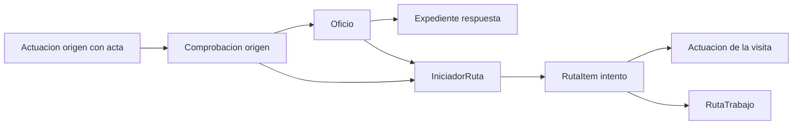

# V1.1-REINSPECCION-CONTRAPROD.0 — Relevamiento del ciclo de reinspección

**Fecha:** 2026-11-10  
**Alcance:** diagnóstico y diseño. Sin cambios de código, datos, migraciones ni estados.  
**Canal analizado:** Completar trabajo sobre un ítem de ruta de **reinspección por oficio** (ratificación de clausura/decomiso y, por analogía, verificar e informar).

Este documento responde: **qué ocurre hoy** al cerrar una reinspección con Cumple, No cumple, o No cumple con contraproducencia; **qué debería ocurrir**; y **cómo implementar** `REINSPECCION-CONTRAPROD.1` sin duplicar visitas ni perder historial.

---

## 1. Comportamiento esperado (contrato del ticket)

| Resultado | Actuación de reinspección | Oficio |
|---|---|---|
| Cumple | Cerrada | Cerrado, no editable |
| No cumple | Cerrada | Cerrado como no cumplido, no editable |
| No cumple con contraproducencia | Vuelve a Pendientes | Pendiente y editable |

Tres capas que no deben confundirse:

| Capa | Qué representa | Dónde vive |
|---|---|---|
| Actuación cerrada | Hecho histórico de **una visita** (OT, fecha, inspectores, actas, evidencias, resultado). | `Actuaciones` + `RutaItem` FINALIZADO |
| Ruta pendiente | Trabajo que **debe volver a realizarse** (nuevo ítem, nueva visita). | `IniciadorRuta.estado_iniciador = PENDIENTE` + pool de planificación |
| Oficio editable | Circuito **administrativo** todavía abierto (número, causa, expediente de respuesta). | Predicado `evaluar_editable_oficio`; **no hay columna** `oficio.estado` |

El oficio no se “cierra” en su tabla. Queda no editable cuando el iniciador de reinspección está `CUMPLIDO` (o inactivo) o hay un ítem abierto en ruta operativa.

---

## 2. Inventario

### 2.1 Modelos

| Entidad | Archivo | Rol en este ciclo |
|---|---|---|
| `Actuaciones` | `Backend/app/models/actuaciones.py` | Visita. Campos: `resultado_cumplimiento_oficio` (`CUMPLE` / `NO_CUMPLE`), `contraproducencia`, `tipo`, inspectores, actas. |
| `IniciadorRuta` | `Backend/app/models/iniciador_ruta.py` | Trabajo planificable. `tipo_iniciador` (genérico `REINSPECCION_OFICIO` o promovido), `estado_iniciador`, `oficio_id`, `comprobacion_id`, `actuacion_id`, `cerrado_motivo`, `prioridad`. |
| `RutaItem` | `Backend/app/models/ruta_item.py` | Intento en una ruta. `estado_ruta_item`, `estado_ejecucion` (`REALIZADO` / `NO_REALIZADO`), `motivo_no_realizado`, `actuacion_id`, evidencias pendientes. |
| `RutaTrabajo` | `Backend/app/models/ruta_trabajo.py` | Contenedor. `BORRADOR` / `PUBLICADA` / `EN_CURSO` / `CERRADA`. |
| `Oficio` | `Backend/app/models/oficio.py` | Documento administrativo. FK a `comprobacion`. `iniciador_materializacion_estado`. **Sin** estado de cumplimiento. |
| `Expediente` | `Backend/app/models/expediente.py` | Envío de acta (`oficio_id` NULL) y respuesta (`tipo_expediente = RESPUESTA_OFICIO`). |
| `Comprobacion` | `Backend/app/models/comprobacion.py` | Ancla documental del circuito. |
| `RutaItemArchivo` | `Backend/app/models/ruta_item_archivo.py` | Evidencias del intento (ancla operativa `ruta_item_id`). |

Tipos de iniciador del circuito oficio (`TIPOS_INI_TRABAJO_OFICIO`):

- `REINSPECCION_OFICIO` (genérico al planificar)
- `VERIFICAR_INFORMAR_OFICIO`
- `RATIFICACION_CLAUSURA_OFICIO`
- `RATIFICACION_DECOMISO_OFICIO`

Al cerrar una visita **realizada**, el genérico se **promueve** al subtipo concreto. Si hay contraproducencia reencolable, se **restaura** a `REINSPECCION_OFICIO` (`reset_iniciador_reinspeccion_oficio_generico`).

### 2.2 Servicios y predicados

| Pieza | Archivo | Qué decide |
|---|---|---|
| Cierre Completar trabajo | `completar_trabajo_cierre_service.py` | Persiste actuación, marca el ítem FINALIZADO, mueve el iniciador. |
| Reencolado | `actuacion_reencolado_service.py` | `aplicar_reencolado_iniciador` (vuelve a `PENDIENTE`, prioridad ≥ 5). `reencolar_iniciador_si_oficio_no_cumple` (**hoy** reencola `NO_CUMPLE` simple). |
| Tipo / promoción | `completar_trabajo_tipo_iniciador.py` | `es_flujo_cumplimiento_oficio`, promoción y reset del subtipo. |
| Contraproducencia | `completar_trabajo_contraproducencia.py` | Bucket `NONE` / `NO_PERMITE` / `NO_EXISTE_LOCAL` / resto reencolable. |
| Oficio editable | `oficio_editable_service.py` | `evaluar_editable_oficio`. Bloquea si iniciador `CUMPLIDO` o inactivo, o ítem **abierto** en ruta `PUBLICADA`/`EN_CURSO`/`CERRADA`. Ítem `FINALIZADO` **no** bloquea. |
| Recorrido por oficio | `comprobacion_oficio_recorrido_service.py` | `iniciador_reinspeccion_por_oficio`, snapshot de ejecución. |
| Bandeja pendientes | `comprobacion_actas_bandeja_service.py` | Oculta si iniciador `CUMPLIDO` o inactivo, o si hay ítem abierto en ruta operativa. |
| Publicar ruta | `ruta_publicar_service.py` + `ruta_publicar_ot_conflicto_service.py` | Crea **nueva** actuación o reutiliza. FIX.5: si hubo `NO_REALIZADO` + actuación, **no reutiliza**. |
| Corregir cierre | `corregir_cierre_oficio_service.py` | Misma política de reencolado desde Gestión. |
| Documental | `comprobacion_documental_service.py` | `puede_editar_bloque_oficio` deriva de `evaluar_editable_oficio`. |

Predicados clave:

- `es_flujo_cumplimiento_oficio`: `REINSPECCION_OFICIO` y las dos ratificaciones. **No** incluye Verificar e informar (ese flujo usa `realizo_nueva_inspeccion`, no `resultado_cumplimiento_oficio`).
- `_tramite_reinspeccion_oficio_cumplido`: `CUMPLIDO` o estados inactivos (`ANULADO`, `CERRADO`, `CERRADO_NO_EXISTE_LOCAL`).
- `iniciador_en_ruta_operativa`: ítem **abierto** (`PENDIENTE_ASIGNACION` / `ASIGNADO` / `EN_PROCESO`) en ruta `PUBLICADA` o `EN_CURSO`. Un `FINALIZADO` no cuenta.
- `iniciador_tiene_intentos_historicos_cerrados`: existe ítem `FINALIZADO` + `NO_REALIZADO` + `actuacion_id`. Dispara “crear actuación nueva” al republicar.

### 2.3 Endpoints

| Método | Ruta | Uso |
|---|---|---|
| POST | `/actuaciones/completar-trabajo/cerrar/<ruta_item_id>` | Cierre canónico. |
| GET | `/actuaciones/completar-trabajo/detalle/<ruta_item_id>` | Prefill Completar trabajo. |
| GET | bandejas de pendientes de reinspección / recorrido | `comprobacion_actas_bandeja_service`. |
| GET/PATCH | `/actuaciones/<id>/comprobacion/documental` y oficios | Edición administrativa del oficio. |
| PUT | `/actuaciones/<id>` | Corrección posterior (Gestión). |
| POST | corregir cierre oficio | `corregir_cierre_oficio`. |
| POST | publicar ruta | Crea o reutiliza actuación del reintento. |

### 2.4 Frontend

| Pieza | Archivo |
|---|---|
| Completar trabajo | `CompletarTrabajoModal.tsx` |
| Submit ratificación | mismo modal: `usaContraReencolado = NO_CUMPLE && contra` |
| Body de cierre | `buildCompletarTrabajoCierreBody.ts` |
| Formulario compartido | `Frontend/src/shared/reinspeccionOficio/*` |
| Verificar e informar | `verificarEstadoOperativo.ts` (`CONTRAPRODUCENCIA` / `NO_INSPECCION` / `SI_INSPECCION`) |
| Editar oficio | `ComprobacionOficioOperativoDialog.tsx` (`puede_editar_bloque_oficio`) |
| Historial / chips | `recorridoOficioExpLabels.ts`, `OficioComprobacionReinspeccionEnCard.tsx` |
| Corregir desde Gestión | `ActuacionDetalleDialog.tsx` + `ReinspeccionOficioForm` |

En Completar trabajo (ratificación):

- Cumple / No cumple se envían como `resultado_cumplimiento_oficio`.
- Si el inspector elige **No cumple y además una contraproducencia**, el front **no manda el resultado**: solo `contraproducencia`. El schema rechaza ambos a la vez (`test_no_cumple_no_mezcla_con_contraproducencia`).

---

## 3. Relaciones

- Un oficio pertenece a una comprobación. Puede haber **varios oficios** en el ciclo; cada uno puede tener su propio iniciador.
- El iniciador es **único y se reencola** (no se crea otro al fallar una visita), salvo anulación.
- Cada intento de campo es un `RutaItem` distinto. El anterior queda `FINALIZADO`.
- La actuación de la visita **debería** ser histórica e inmutable tras `REALIZADO`. Hoy eso se cumple bien en contraproducencia (FIX.5) y **no** está garantizado en `NO_CUMPLE` simple.

---

## 4. Matriz actual vs esperado

Leyenda: **OK** = ya coincide. **GAP** = hay que cambiar en `.1`.

### 4.1 Ratificación / `resultado_cumplimiento_oficio`

| Resultado UI | Qué se persiste hoy | `RutaItem` | `IniciadorRuta` | Oficio editable | Vuelve a Pendientes | Esperado |
|---|---|---|---|---|---|---|
| Cumple | `resultado = CUMPLE`, sin contra | FINALIZADO / REALIZADO | `CUMPLIDO` (promovido) | No (`CUMPLIDO`) | No | OK |
| No cumple | `resultado = NO_CUMPLE`, sin contra | FINALIZADO / **REALIZADO** | Pasa por `CUMPLIDO` y **reencola a `PENDIENTE`** con `cerrado_motivo = OFICIO_NO_CUMPLE` | **Sí** (iniciador pendiente, ítem ya finalizado) | **Sí** (pool + bandeja) | **GAP**: actuación e iniciador deberían quedar cerrados; oficio no editable |
| No cumple + contra | Solo `contraproducencia` (sin resultado) | FINALIZADO / **NO_REALIZADO** | `PENDIENTE`, reset a `REINSPECCION_OFICIO` | Sí | Sí | OK |

Confirmado por código y tests:

- `reencolar_iniciador_si_oficio_no_cumple` corre **después** de marcar `CUMPLIDO` cuando no hay contra.
- `test_no_cumple_reencola_iniciador_a_pendiente` fija el comportamiento actual (el GAP).
- `test_no_se_ratifico_reencola_iniciador` / `LOCAL CERRADO` cubren el camino correcto de contraproducencia.

### 4.2 Verificar e informar (fuera de la tabla de tres filas, mismo circuito)

No usa `resultado_cumplimiento_oficio`. Máquina: Contraproducencia / No realizó inspección / Sí realizó inspección.

| Estado | Ítem | Iniciador | ¿Reabre? |
|---|---|---|---|
| Sí inspección | REALIZADO | CUMPLIDO | No |
| No inspección | REALIZADO | CUMPLIDO | No |
| Contraproducencia | NO_REALIZADO | PENDIENTE | Sí |

Alineado con “solo contraproducencia reabre”. No mezclar con Cumple/No cumple de ratificación.

### 4.3 `NO PERMITE INSPECCION`

- Sin acta de comprobación: NO_REALIZADO + reencolado (visita no realizada).
- Con acta válida: REALIZADO + CUMPLIDO (cierra).

Es familia de contraproducencia, no de “No cumple” administrativo.

---

## 5. Tres casos trazados

Escenario común: comprobación origen → expediente de envío → oficio → expediente de respuesta → iniciador `REINSPECCION_OFICIO` en ruta `PUBLICADA` → Completar trabajo.

### Caso A — Cumple

1. Inspector elige tipo (p. ej. Ratificación de clausura) y **Cumple**. Sin contra.
2. Body: `resultado_cumplimiento_oficio = CUMPLE`.
3. Bucket `NONE`: se aplican actas si las hay; `resultado` queda `CUMPLE`.
4. Ítem: `REALIZADO` + `FINALIZADO`.
5. Iniciador: `CUMPLIDO`, se promueve el subtipo, `cerrado_motivo` vacío.
6. `reencolar_iniciador_si_oficio_no_cumple` no hace nada (resultado ≠ `NO_CUMPLE`).
7. Bandeja de pendientes: oculto. Oficio: no editable. Historial: chip **Cumple**. Completar trabajo: ítem ya cerrado.

Coincide con lo esperado.

### Caso B — No cumple (visita realizada)

1. Inspector elige **No cumple** y **no** carga contraproducencia.
2. Body: `resultado_cumplimiento_oficio = NO_CUMPLE`.
3. Bucket `NONE`: visita **realizada**. Ítem `REALIZADO` + `FINALIZADO`. Actuación conserva inspectores, actas y evidencias de **esa** visita.
4. Iniciador se pone `CUMPLIDO` y acto seguido `reencolar_iniciador_si_oficio_no_cumple` lo vuelve `PENDIENTE` (`cerrado_motivo = OFICIO_NO_CUMPLE`, prioridad ≥ 5).
5. Como el ítem ya está `FINALIZADO`, **no** hay ruta operativa abierta → `evaluar_editable_oficio` queda **editable**.
6. Bandeja de pendientes y pool de planificación **vuelven a mostrar** el trámite.
7. Al republicar: FIX.5 **no** aplica (el intento fue `REALIZADO`, no `NO_REALIZADO`). El publicador **puede reutilizar** la misma actuación y **borra** `resultado_cumplimiento_oficio` al publicar.

Hoy reencola de forma incorrecta. Riesgo extra: mutar o duplicar la visita histórica.

### Caso C — No cumple con contraproducencia

1. Inspector elige No cumple **y** una contra permitida (p. ej. Local cerrado, No se ratificó, No pagó el decomiso).
2. Body: solo `contraproducencia`. Sin resultado.
3. Bucket reencolable: ítem `NO_REALIZADO` + `FINALIZADO` + `motivo_no_realizado`.
4. Actuación: se guarda la contra; **no** se labran actas del día.
5. Iniciador: `PENDIENTE`, `tipo_iniciador` vuelve a `REINSPECCION_OFICIO`.
6. Oficio editable. Bandeja y pool: visible.
7. Al republicar: FIX.5 ve historial `NO_REALIZADO` → **crea actuación nueva** y **nuevo** `RutaItem`. La visita anterior no se toca (inspectores, evidencias, contra).

Coincide con lo esperado. Es la **única** combinación que debe reabrir.

---

## 6. Respuestas a las confirmaciones del ticket

| Pregunta | Hallazgo |
|---|---|
| ¿Hoy `No cumple` simple reencola el oficio? | **Sí.** Es comportamiento testeado (`test_no_cumple_reencola_iniciador_a_pendiente`), no un accidente aislado de UI. |
| ¿Solo `No cumple` + contraproducencia debe reabrir? | **Sí.** El front ya no envía resultado cuando hay contra. El backend rechaza el híbrido. Verificar e informar ya cierra SI/NO inspección y solo reabre con contra. |
| ¿La reapertura conserva evidencias, inspectores, historial? | En el camino **contra** (C): sí, porque el reintento es otro ítem y, por FIX.5, otra actuación. En el camino **No cumple** (B): la visita quedó `REALIZADO`; si se republica se puede **reutilizar y borrar el resultado**. |
| ¿Vuelve la misma actuación o se crea otra? | Contra: **otra actuación** (correcto). No cumple simple: **indefinido** (reutilizar o crear). No aceptar reutilizar una visita `REALIZADO`. |
| ¿El oficio tiene estado propio? | **No.** “Cerrado / editable” es el predicado sobre iniciador + ruta. |

---

## 7. Riesgos

| Riesgo | Dónde | Mitigación en `.1` |
|---|---|---|
| Reapertura indebida de `NO_CUMPLE` | `reencolar_iniciador_si_oficio_no_cumple` + `corregir_cierre_oficio_service` | No reencolar si la visita fue `REALIZADO`. Dejar iniciador `CUMPLIDO`. |
| Oficio editable con trámite ya visitado | `evaluar_editable_oficio` mira `CUMPLIDO` / ítem abierto, no el resultado | Al no reencolar, `CUMPLIDO` vuelve a bloquear edición. |
| Reutilizar actuación `REALIZADO` y borrar `resultado` | `ruta_publicar_service` pone `resultado_cumplimiento_oficio = None` | Dejar de mandar esos casos al pool. Opcional: no reutilizar si `estado_ejecucion = REALIZADO`. |
| Label “Reinspección cumplida” para un No cumple | `estado_recorrido_label` si iniciador `CUMPLIDO` | En `.1`, ramificar por `resultado_cumplimiento_oficio`. Los chips de recorrido ya leen Cumple / No cumple. |
| Doble cómputo / dos actuaciones | Publicar un No cumple reencolado | Deja de ocurrir si no vuelve a pendientes. |
| Varios oficios | Un iniciador por oficio | Cerrar uno no debe tocar el otro. Tests de recorrido de varios oficios (`test_seguimiento_historial_v1_1`) deben seguir verdes. |
| Corregir cierre desde Gestión | `corregir_cierre_oficio_service._aplicar_no_cumple` también reencola | Misma regla que Completar trabajo. |
| `NO_EXISTE_LOCAL` | Cierra el iniciador (`CERRADO_NO_EXISTE_LOCAL`) | No reabrir. Fuera del contrato de las tres filas; no cambiar. |
| Motivos de comprobación | — | Fuera de alcance. |
| Indicadores / carga manual | — | Otro ticket. |

---

## 8. Propuesta para `REINSPECCION-CONTRAPROD.1`

Cambio mínimo, sin migración, sin nuevo enum de oficio.

### 8.1 Regla de negocio

Tras Completar trabajo (y al corregir cierre) en flujo de cumplimiento de oficio/ratificación:

1. **Visita realizada** (`bucket NONE`, ítem `REALIZADO`):
   - Iniciador **siempre** `CUMPLIDO` (promovido al subtipo).
   - `resultado_cumplimiento_oficio` = `CUMPLE` o `NO_CUMPLE`.
   - **No** llamar a `reencolar_iniciador_si_oficio_no_cumple` (o dejarlo no-op).
   - Opcional: `cerrado_motivo = OFICIO_NO_CUMPLE` solo como traza, **sin** pasar a `PENDIENTE`.
2. **Visita no realizada** (contraproducencia reencolable, incluido “No cumple + contra” del UI):
   - Ítem `NO_REALIZADO` + `FINALIZADO`.
   - Iniciador `PENDIENTE`, reset a `REINSPECCION_OFICIO`.
   - Oficio editable. Vuelve al pool. Nueva actuación en la siguiente publicación (FIX.5).
3. No crear relación automática motivo ↔ oficio. No tocar multimedia, domicilios ni comprobación.

### 8.2 Por qué no hace falta un estado nuevo de oficio

“Oficio cerrado” = iniciador `CUMPLIDO` (o inactivo) ⇒ `evaluar_editable_oficio` falso.  
“No cumplido” = `Actuaciones.resultado_cumplimiento_oficio = NO_CUMPLE` en la visita `REALIZADO`.  
Un enum nuevo en `Oficio` o `CERRADO_NO_CUMPLE` en el iniciador sería más costoso y no hace falta para bloquear edición ni para el historial (los chips ya leen el resultado).

Si en `.1` el copy de recorrido (“Reinspección cumplida”) confunde, ajustar **labels**, no el modelo.

### 8.3 Archivos a tocar en `.1` (orientativo)

- `actuacion_reencolado_service.py` — dejar de reencolar `NO_CUMPLE` realizado.
- `completar_trabajo_cierre_service.py` — solo si el orden CUMPLIDO → reencolar queda código muerto.
- `corregir_cierre_oficio_service.py` — misma regla.
- Presenters de recorrido — distinguir Cumple vs No cumple cuando el iniciador está `CUMPLIDO`.
- Tests: invertir `test_no_cumple_reencola_iniciador_a_pendiente`; añadir los tres casos de la matriz; no romper `test_reinspeccion_oficio_reencolado` (contra) ni hotfix de reinspección.

Frontend: el submit de Completar trabajo **ya** separa los tres caminos. `.1` no debería cambiar el formulario salvo textos de ayuda (“No cumple cierra el oficio; con contraproducencia vuelve a ruta”).

### 8.4 Qué no hacer

- No reutilizar ni borrar la actuación `REALIZADO` del No cumple.
- No crear un segundo iniciador ni un segundo oficio.
- No reabrir por PUT de Gestión si ya hay un reintento en curso (FIX.9 se mantiene).
- No migraciones salvo que un test demuestre un hueco de esquema (no se ve uno).

---

## 9. Pruebas para `.1`

### Backend

- Crear reinspección por oficio y cerrar **Cumple**: iniciador `CUMPLIDO`, ítem `REALIZADO`, oficio `editable=False`, no aparece en pendientes ni en pool.
- Cerrar **No cumple** sin contra: igual de cerrado; `resultado = NO_CUMPLE`; `cerrado_motivo` no implica `PENDIENTE`; no reencola.
- Cerrar **No cumple + contra** (o contra sola permitida): ítem `NO_REALIZADO`, iniciador `PENDIENTE`, oficio editable, aparece en bandeja; al publicar se crea **otra** actuación; la anterior conserva contra e inspectores.
- Rechazo de payload con resultado y contra a la vez (ya existe).
- `CUMPLE` no reencola (regresión).
- Varios oficios: cerrar uno en No cumple no altera el otro.
- Corregir cierre: Cumple ↔ No cumple no reabre; pasar a contra sí; quitar contra de un reencolado sigue las reglas actuales de corrección.
- Verificar e informar: SI/NO inspección siguen `CUMPLIDO`; contra sigue reencolando.
- `NO_EXISTE_LOCAL` sigue cierre lógico, sin pool.
- Oficio con `No cumple` **no** entra a `iniciador_en_ruta_operativa` ni a “Editar oficio”.

### Frontend

- Completar trabajo ratificación: Cumple / No cumple / No cumple + contra arman el body como hoy.
- Completar trabajo no ofrece contra en Cumple.
- Historial y card de oficio: chips **Cumple** y **No cumple** sin reducir a uno; contra muestra “No realizada” + motivo.
- Botón/permiso Editar oficio: visible solo en el caso contra/pendiente.
- Gestión: una actuación de visita `REALIZADO` no se presenta como pendiente de ruta.

### QA manual

1. Circuito completo hasta Completar trabajo. Cerrar **Cumple**. Verificar que desaparece de Pendientes, el oficio no se edita, historial dice Cumple.
2. Otro circuito. Cerrar **No cumple** sin contra. La actuación queda cerrada; el oficio **no** vuelve a pendientes ni se puede editar; historial dice No cumple.
3. Otro circuito. Cerrar **No cumple** con Local cerrado (u otra contra válida). Vuelve a Pendientes; el oficio se puede editar; al armar otra ruta aparece un trabajo nuevo; la visita anterior sigue en historial con la contra.
4. Oficio en No cumple no debe reencolarse al abrir Ver actuación / Editar / Historial.
5. Un segundo oficio de la misma comprobación conserva su propio estado.
6. Evidencias e inspectores de la visita realizada siguen en esa actuación; el reintento por contra no los pisa.

---

## 10. Fuera de alcance

- Motivos de comprobación (MOTIVOS.2 cerrado).
- Indicadores y actuaciones cargadas a mano.
- Multimedia, domicilios, contribuyentes, permisos, exportaciones.
- Cambiar estados actuales en este ticket (`.0` es solo relevamiento).
